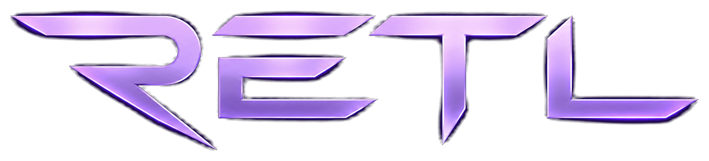

<div align="center">



# RETL — Developer Portfolio

**Building ideas into real things.**
A cinematic, dark-and-purple portfolio with a robot-eye intro, a command palette, holographic cards, a drifting 3D project wall and a lot of small details.

[](https://github.com/rheillunio2-byte/RETL-Portfolio/stargazers)
[](https://github.com/rheillunio2-byte/RETL-Portfolio/network/members)
[](https://github.com/rheillunio2-byte/RETL-Portfolio/issues)


</div>

<!-- Add a screenshot or GIF at docs/preview.png, then uncomment:
<p align="center"></p>
-->

> ### ⭐ Like this portfolio? Leave a star!
> If this project inspired you, taught you something, or just looked cool, **[give it a star on GitHub](https://github.com/rheillunio2-byte/RETL-Portfolio)**. It's free, takes one click, and helps other people find it. Forks, remixes and ideas are welcome too — see [CONTRIBUTING.md](CONTRIBUTING.md).

---

## Contents

- [Highlights](#highlights)
- [Tech stack](#tech-stack)
- [Quick start](#quick-start)
- [Keyboard shortcuts & easter eggs](#keyboard-shortcuts--easter-eggs)
- [Project structure](#project-structure)
- [Make it yours](#make-it-yours)
- [Deploy](#deploy)
- [Accessibility & performance](#accessibility--performance)
- [Contributing](#contributing)
- [License & credits](#license--credits)
- [Connect](#connect)

## Highlights

**The experience**

| | |
|---|---|
| 🎬 **Cinematic intro** | A cold-boot terminal types out, a robot eye glitches awake, scans the room and tracks your cursor, asks *"Are you ready?"*, then dives into the pupil while particles form the RETL emblem. A React Bits **Crosshair** follows the cursor, locks onto buttons and pings on click. Skippable (button / <kbd>Esc</kbd>); the Enter button unlocks only once the page has really loaded. Reduced-motion visitors bypass it. |
| ⌨️ **Command palette** | <kbd>Ctrl/⌘</kbd> + <kbd>K</kbd> or <kbd>/</kbd>: fuzzy-search sections, open any project repo, visit socials, copy the email. It builds itself from the page, so new projects appear automatically. |
| ⚡ **ElectricLogo** | Lightning traces the RETL emblem in the hero and reacts to the cursor (WebGL via `ogl`). |
| 🪄 **Hero details** | Cursor-lit grid spotlight, typed role line, line-reveal headline, live Cagayan de Oro clock, parallax, magnetic buttons. |
| 🖼️ **ScrollExpand** | A framed banner opens to full-bleed as you scroll. |
| 🃏 **HoloCard** | A holographic developer card: hover to tilt, click to flip. |
| 🧱 **DriftWall** | A drifting 3D wall of project tiles that each link to their repo. |
| 📸 **Photo deck** | *Off the clock*: drag, flick or click to throw the top photo to the back; duotone-to-colour reveal, tilt, glare and a scan sweep. |
| 🗂️ **Certificates folder** | Click to open, drag a certificate out, click to zoom in a lightbox. |
| ✍️ **TechText** | A draggable, kickable RETL wordmark in the sign-off. |
| ❤️ **PulseHeart** | Visitors can heart the portfolio and each project. |
| ⭐ **Star CTA** | A live GitHub star counter and a burst of stars when you click through. |

**The details**

- Scroll-progress bar, staggered reveals, drawing section rules, scroll-reactive marquee (speed, direction and skew follow your scroll), scroll-drawn timeline
- Interactive particle network that reacts to your cursor
- Floating **Dock** navigation instead of a sidebar, with active-section tracking
- Project category tabs, curated featured work **plus live GitHub repository sync**
- Working contact form with validation, honeypot, cooldown and a `mailto:` fallback
- Silent by design. The portfolio makes no sound.

## Tech stack

| Layer | Tools |
|---|---|
| Build | [Vite 6](https://vitejs.dev) (no framework plugin; React uses the automatic JSX runtime) |
| UI islands | [React 19](https://react.dev) + [React Bits](https://reactbits.dev)-style components, mounted and lazy-loaded from `src/islands.jsx` |
| WebGL | [`ogl`](https://github.com/oframe/ogl) for ElectricLogo |
| Icons | `react-icons`, `@hugeicons/core-free-icons` |
| Page, styles & logic | Hand-written HTML, CSS and vanilla ES modules |
| Data | GitHub REST API (public repos and star count), FormSubmit (contact form) |

The page itself is plain HTML + vanilla JS. React is used only for self-contained "islands" (Dock, ScrollExpand, HoloCard, DriftWall, Folder, LogoLoop, PulseHeart, TechText, ElectricLogo, Crosshair), and the heavy ones are code-split so they only start once they approach the viewport.

## Quick start

Requires **Node.js 18+**.

```bash
git clone https://github.com/rheillunio2-byte/RETL-Portfolio.git
cd RETL-Portfolio
npm install
npm run dev
```

Open the URL Vite prints (usually `http://localhost:5173`).

| Script | What it does |
|---|---|
| `npm run dev` | Dev server with hot reload (also reachable on your LAN) |
| `npm run build` | Production build into `dist/` |
| `npm run preview` | Serve the production build locally |

## Keyboard shortcuts & easter eggs

| Keys | Action |
|---|---|
| <kbd>Ctrl/⌘</kbd> + <kbd>K</kbd> · <kbd>/</kbd> | Open the command palette |
| <kbd>↑</kbd> <kbd>↓</kbd> <kbd>↵</kbd> | Navigate / run a palette command |
| <kbd>Esc</kbd> | Close the palette or lightbox, or skip the intro |
| <kbd>Enter</kbd> / <kbd>Space</kbd> | Enter the portfolio from the intro |
| <kbd>←</kbd> <kbd>→</kbd> | Cycle the photo deck |
| ↑ ↑ ↓ ↓ ← → ← → <kbd>B</kbd> <kbd>A</kbd> | Something is hiding… (or run **Run debug mode** from the palette) |

## Project structure

```text
RETL-Portfolio/
├── index.html              # All page content (sections, projects, timeline, photo deck, star CTA)
├── logo.svg                # Brand icon
├── vite.config.js
├── public/                 # Served as-is
│   ├── brand/              # Wordmark + emblem (tight + mask versions)
│   ├── art/                # Hero card faces, project tiles, banner, photo-deck images
│   └── certs/              # Certificates (full-size + folder cards)
└── src/
    ├── main.js             # Reveals, filters, particles, scroll flow, GitHub sync, contact form
    ├── extras.js / .css    # Command palette, hero spotlight, clock, marquee, easter egg
    ├── frames.js / .css    # Photo deck ("Off the clock")
    ├── star.js / .css      # "Star the repo" CTA
    ├── intro.js / boot.css # Cinematic intro (copy, timing and look)
    ├── boot-logo.js        # Particles that form the RETL emblem on exit
    ├── islands.jsx         # Mounts the React components into placeholders in index.html
    ├── likes.js            # Heart counts (localStorage, optional global endpoint)
    ├── style.css           # Global design system and section styles
    └── components/         # Dock, ScrollExpand, HoloCard, DriftWall, Folder, LogoLoop,
                            # PulseHeart, TechText, ElectricLogo, Crosshair (+ CSS)
```

## Make it yours

Fork it and swap in your own details. These are the places to touch:

| I want to change… | Edit |
|---|---|
| Name, bio, sections, projects, timeline, socials | `index.html` |
| **GitHub username** (live repo sync, star count) | `src/main.js` (`fetch(".../users/<you>/repos")` and `known`), `src/star.js` (`REPO`), `src/islands.jsx` (`REPOS`) |
| Intro wording and timing | `INTRO_COPY`, `BOOT_LINES`, `OPEN` / `LOOK` at the top of `src/intro.js` |
| Crosshair look in the intro | `INTRO_CROSSHAIR` in `src/intro.js` |
| Colours and fonts | CSS variables at the top of `src/style.css` (`--bg`, `--purple`, `--font`, `--mono`) |
| Project tiles on the drift wall | `public/art/tile-<slug>.jpg` (600×400) and the list in `src/islands.jsx` |
| Photo deck | The two `<figure class="frame">` blocks in `index.html` + files in `public/art/` |
| Certificates | Drop images in `public/certs/`, add to the `Folder` items in `src/islands.jsx` and a card in `index.html` |
| Logo / favicon | `public/brand/`, `public/favicon.png`, `logo.svg` |
| Palette entries | `gatherItems()` in `src/extras.js` |

### Contact form

The form posts to [FormSubmit](https://formsubmit.co) and lands in the inbox configured in `src/main.js` (`EMAIL`).
**One-time setup:** the first submission triggers an activation email. Click *Activate* once and every later message is delivered. If the request fails, visitors get a prefilled `mailto:` fallback; a hidden honeypot, validation and a 45 s cooldown limit spam.

### Hearts

Likes are remembered per visitor in `localStorage` (`src/likes.js`). For **global** counts, deploy any endpoint that answers `GET ?id=<id>` → `{ "count": n }` and `POST { id, delta }` → `{ "count": n }`, then set `VITE_LIKES_ENDPOINT` in a `.env` file.

### Star CTA

`src/star.js` reads `stargazers_count` from the GitHub API (cached for 10 minutes per session). If the repo is private, not yet public, or rate-limited, the count quietly hides and the button still works.

## Deploy

It's a static Vite site, so any static host works.

- **Vercel / Netlify / Cloudflare Pages** (recommended): import the repo, build command `npm run build`, output directory `dist`. Zero config.
- **GitHub Pages**: works as a *user/organisation site* (`<user>.github.io`) or on a custom domain. Several assets are referenced with root-absolute paths (`/art/…`, `/brand/…`), so a *project site* served from `/RETL-Portfolio/` needs those paths made base-aware first.

## Accessibility & performance

- Respects `prefers-reduced-motion`: the intro is skipped and the heavy animation is toned down or disabled
- Keyboard-friendly: palette, photo deck, dock, lightbox and intro are all operable without a mouse; dialogs manage focus and close with <kbd>Esc</kbd>
- Semantic landmarks, labelled controls and descriptive alt text
- Heavy WebGL / canvas islands are code-split and lazy-mounted near the viewport; images are lazy-loaded and web-optimised
- Fully responsive, with desktop-only pointer effects disabled on touch devices

## Contributing

Bug reports, fixes, accessibility improvements and ideas are very welcome. Please read **[CONTRIBUTING.md](CONTRIBUTING.md)** first. It also explains what *not* to send (the personal content is mine).

## License & credits

- **Code:** you're welcome to read it, learn from it and take inspiration. If you build on it, please credit the project and link back.
- **Personal content** (photos, certificates, logo and brand art, bio and copy) belongs to RETL and is not licensed for reuse.
- Component patterns are inspired by [React Bits](https://reactbits.dev). Fonts: [Manrope](https://fonts.google.com/specimen/Manrope) and [DM Mono](https://fonts.google.com/specimen/DM+Mono) via Google Fonts.

## Connect

**Rheil Evans Lunio (RETL)**: Computer Science student & developer, Cagayan de Oro, Philippines

[GitHub](https://github.com/rheillunio2-byte) · [LinkedIn](https://www.linkedin.com/in/rheil-evans-lunio-039560423/) · [Instagram](https://www.instagram.com/i_onre/) · [TikTok](https://www.tiktok.com/@i_onremf) · [Facebook](https://www.facebook.com/rheil.evans) · [rheillunio2@gmail.com](mailto:rheillunio2@gmail.com)

<div align="center">

**If you made it this far, a ⭐ would mean a lot.**
[Star the repo](https://github.com/rheillunio2-byte/RETL-Portfolio)

</div>
